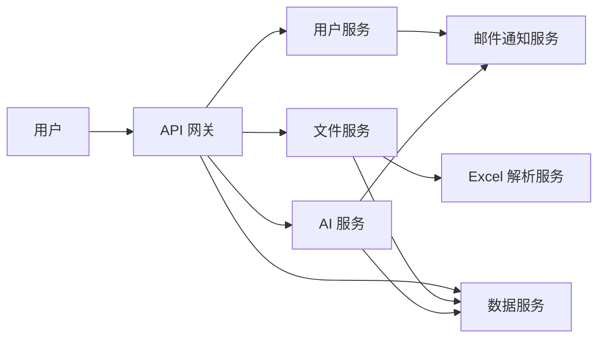

# 基于LLM的微服务智能数据处理平台

面向 Excel 文件和数据库的自然语言数据处理平台。用户通过对话提出查询、统计和分析需求，系统负责理解问题、访问数据、组织结果，并保存可追溯的会话记录。

## 完整项目的使用效果

1. 用户注册并登录后，可上传 Excel 文件，查看工作表、预览数据、管理已上传文件，也可连接已有数据库。
2. 用户用自然语言提出问题，例如“按月份统计销售额并找出增长最快的产品”。AI 服务结合当前数据源生成处理方案；涉及数据库查询时，先校验候选 SQL，再交由数据服务执行。
3. 平台返回查询结果与文字分析，并将文件、数据源和聊天会话关联起来，便于继续追问和回看历史记录。
4. 网关统一接收客户端请求，完成身份校验和请求转发；各业务服务通过 RPC 协作，邮件服务处理验证码及结果通知。

## 系统组成



| 服务 | 职责 |
| --- | --- |
| API 网关 | HTTP 接入、鉴权、协议转换与服务路由 |
| 用户服务 | 注册登录、会话管理与用户信息 |
| 文件服务 | 文件上传下载、预览与数据源关联 |
| Excel 解析服务 | 工作表识别和表格数据解析 |
| 数据服务 | 数据持久化、查询与连接管理 |
| AI 服务 | 自然语言理解、查询方案生成和结果解释 |
| 邮件通知服务 | 验证码与分析结果通知 |

## 当前仓库代码

仓库中的 `cpp-microservice-scaffold` 提供 C++17 基础封装和对应实验：

```text
cpp-microservice-scaffold/
├── source/
│   ├── json_util.{h,cc}  # JSON 序列化与反序列化
│   ├── log.{h,cc}        # 日志初始化
│   └── rpc.{h,cc}        # brpc Channel 节点管理与轮询选择
└── test/
    ├── jsoncpp/          # JSON 封装实验
    ├── rpc/              # Channel 管理实验
    └── log_test.cc       # 日志实验
```

这些基础封装是业务服务的底层代码；上文描述的是完整平台的交付形态，业务服务源码不在当前提交中。

## 编译基础实验

在安装 C++17 编译器及相应依赖的 Ubuntu 开发环境中，可分别运行：

```bash
cd cpp-microservice-scaffold/test
make log_test

cd rpc
make channels_test
```

依赖包括 brpc、protobuf、gflags、spdlog、jsoncpp、fmt 和 GoogleTest；具体链接参数见各实验目录的 `makefile`。
